<p align="center">
  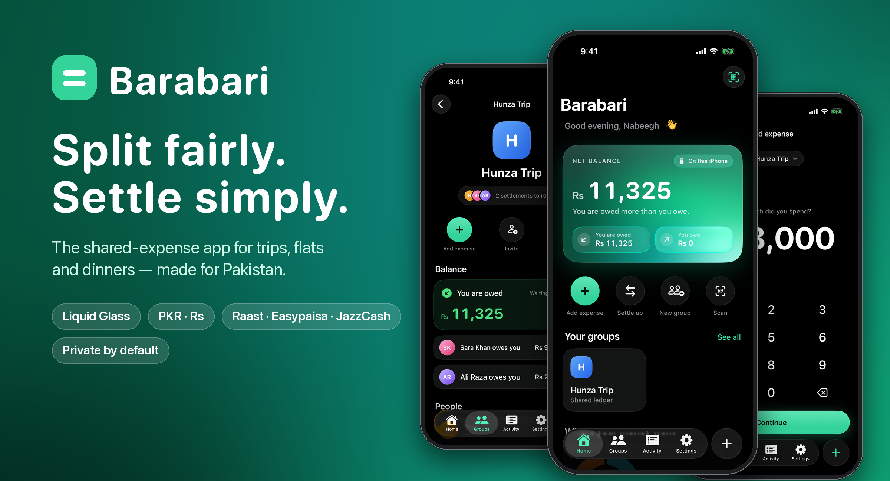
</p>

<h1 align="center">Barabari</h1>

<p align="center">
  <b>Split fairly. Settle simply.</b><br>
  A shared-expense app for iPhone, made for how friends in Pakistan actually split money.
</p>

<p align="center">
  <a href="https://barabari.site"><b>barabari.site</b></a>
</p>

<p align="center">
  
  
  
  
</p>

---

## What is Barabari?

**Barabari** (برابری) means *equality* in Urdu. The app is for anything you pay for together: a trip to Hunza, rent on a shared flat, a Friday karahi night.

Add what you spent, choose who it's split with, and Barabari shows who owes whom. When someone pays you back over **Raast, Easypaisa, JazzCash**, a bank transfer or cash, you record it in a tap. Barabari **never moves money**. It just keeps the record clear, so no one has to remember who paid for the petrol.

Everything is stored **on your iPhone**. There's no account, no sign-up and no server.

---

## A quick tour

<table>
  <tr>
    <td align="center" width="33%">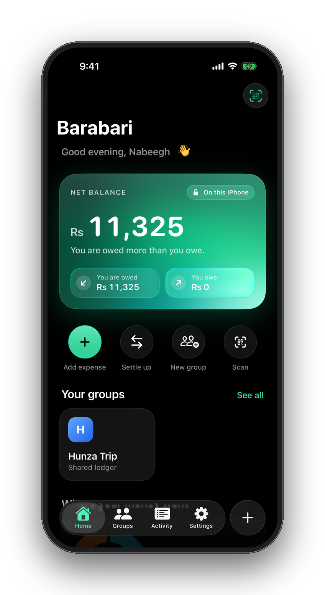<br><b>Your balance at a glance</b><br><sub>An animated emerald card shows what you're owed and what you owe.</sub></td>
    <td align="center" width="33%">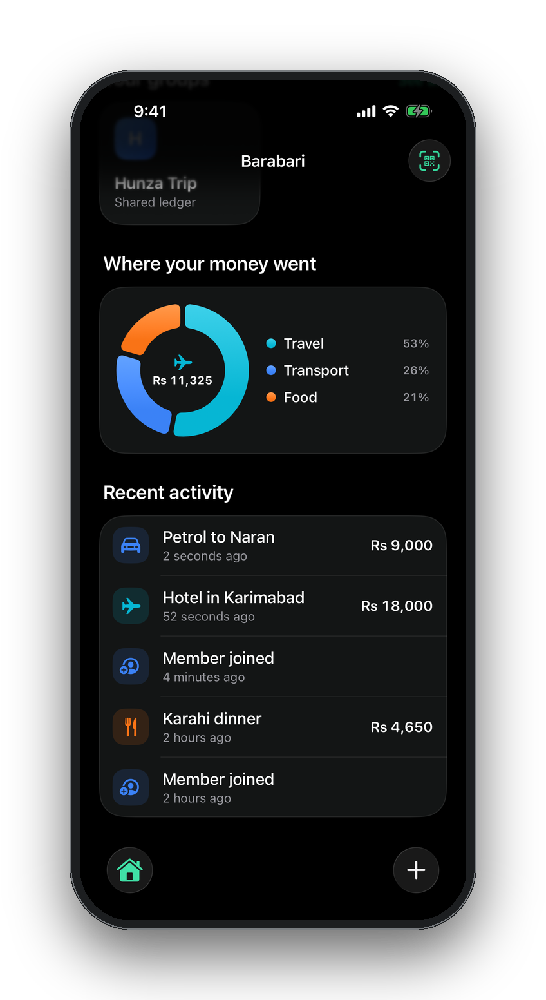<br><b>Where your money went</b><br><sub>A tappable chart of your spending by category, plus recent activity.</sub></td>
    <td align="center" width="33%">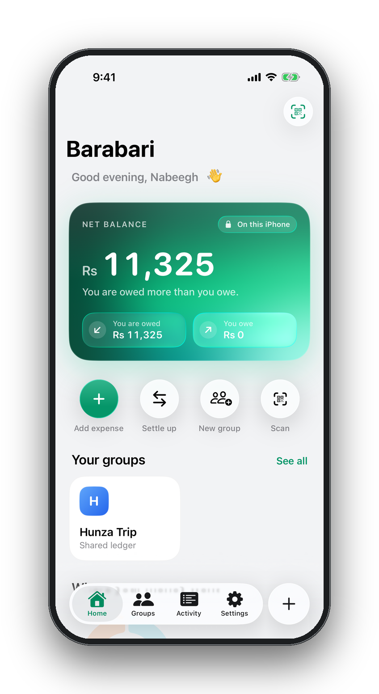<br><b>Light & dark</b><br><sub>Looks good in both appearances, or follows your system setting.</sub></td>
  </tr>
</table>

### Adding an expense in seconds

<table>
  <tr>
    <td align="center" width="25%">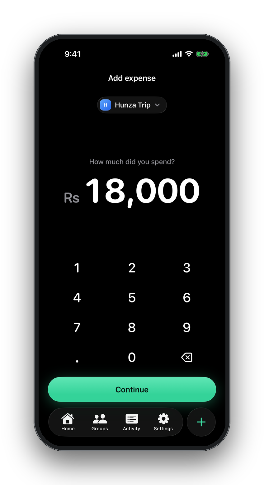<br><b>1. Amount</b><br><sub>A big keypad that formats as you type (Rs 18,000).</sub></td>
    <td align="center" width="25%">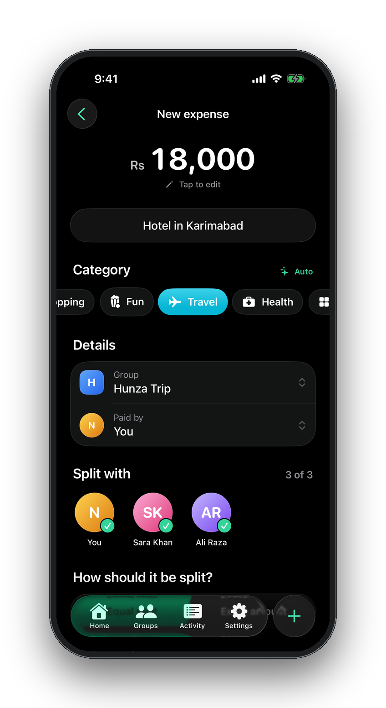<br><b>2. Details</b><br><sub>The category is picked from the title: “Hotel” → Travel ✈️</sub></td>
    <td align="center" width="25%">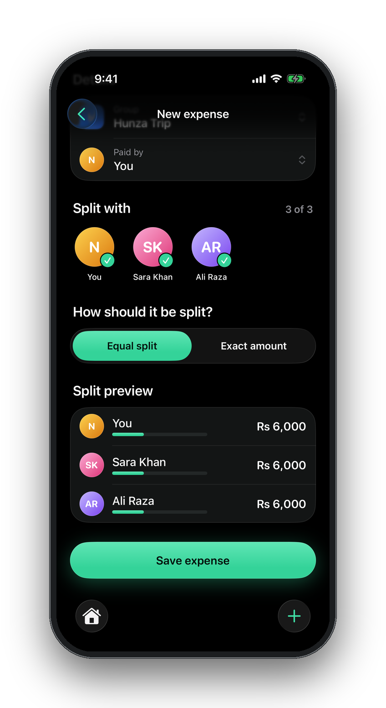<br><b>3. Split</b><br><sub>Equal or exact amounts, with a live preview of each share.</sub></td>
    <td align="center" width="25%">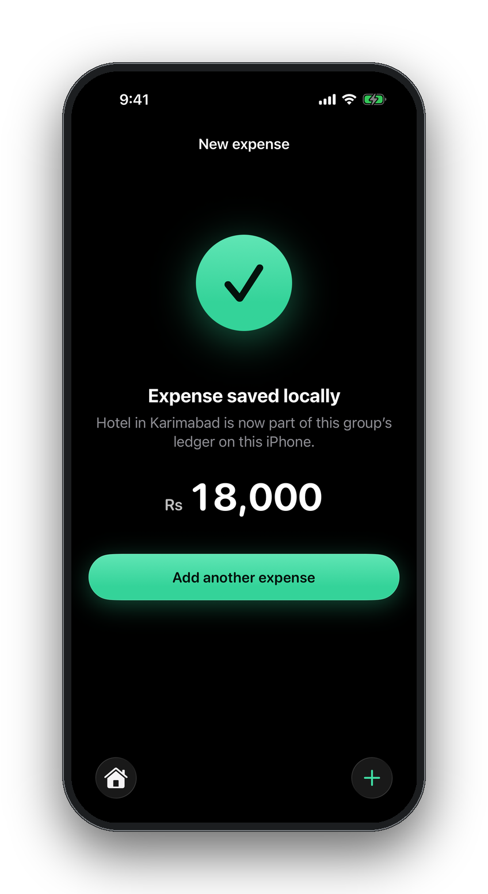<br><b>4. Done</b><br><sub>A satisfying checkmark animation when it's saved.</sub></td>
  </tr>
</table>

### Groups, reminders & settling up

<table>
  <tr>
    <td align="center" width="33%">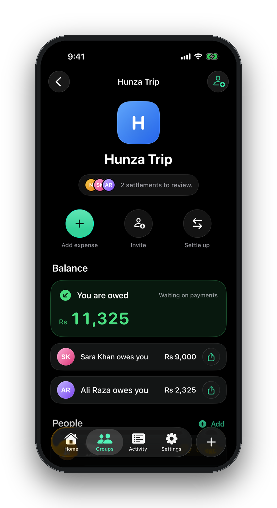<br><b>Groups with real people</b><br><sub>Add friends by name, see who owes whom, and settle up.</sub></td>
    <td align="center" width="33%">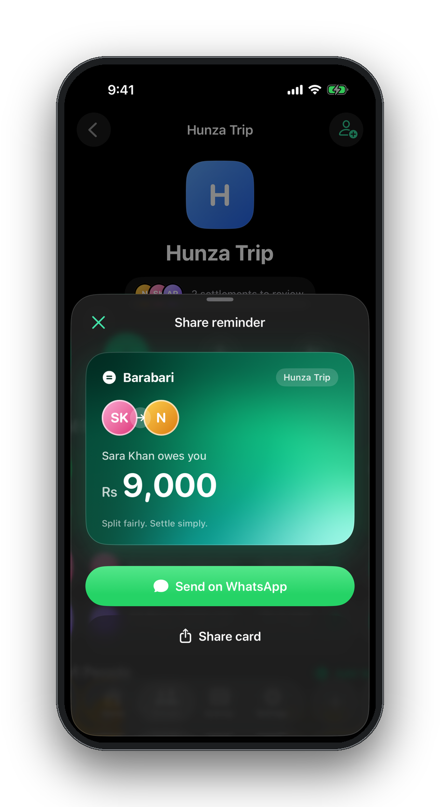<br><b>WhatsApp reminders</b><br><sub>Send a friendly balance card instead of an awkward message.</sub></td>
    <td align="center" width="33%">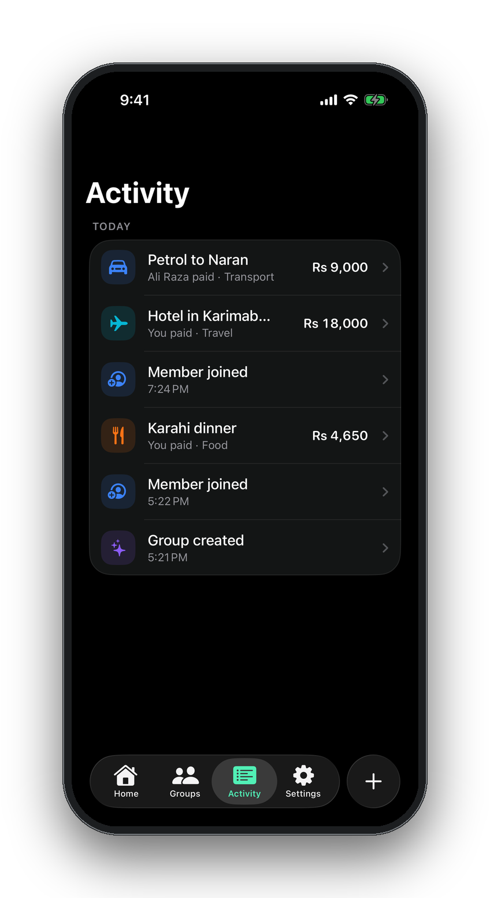<br><b>Activity, like a bank statement</b><br><sub>Grouped by day, with who paid and what it was for.</sub></td>
  </tr>
</table>

### First launch & settings

<table>
  <tr>
    <td align="center" width="25%">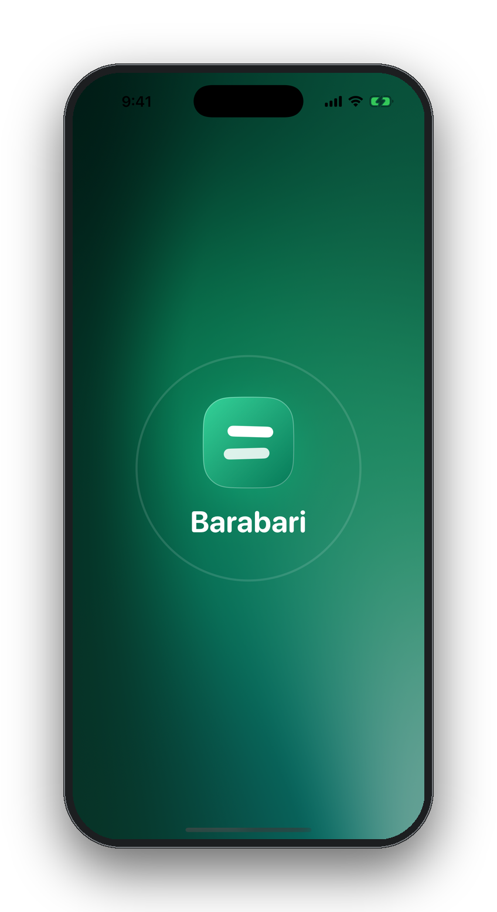<br><b>Animated splash</b></td>
    <td align="center" width="25%">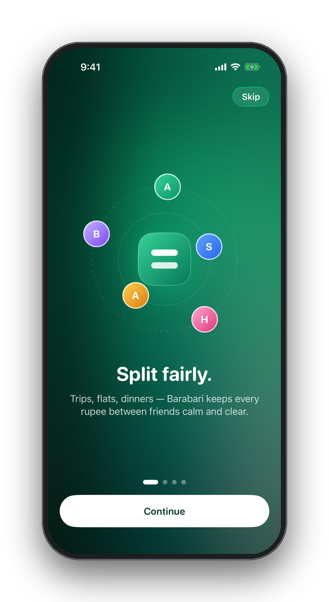<br><b>Welcome tour</b></td>
    <td align="center" width="25%">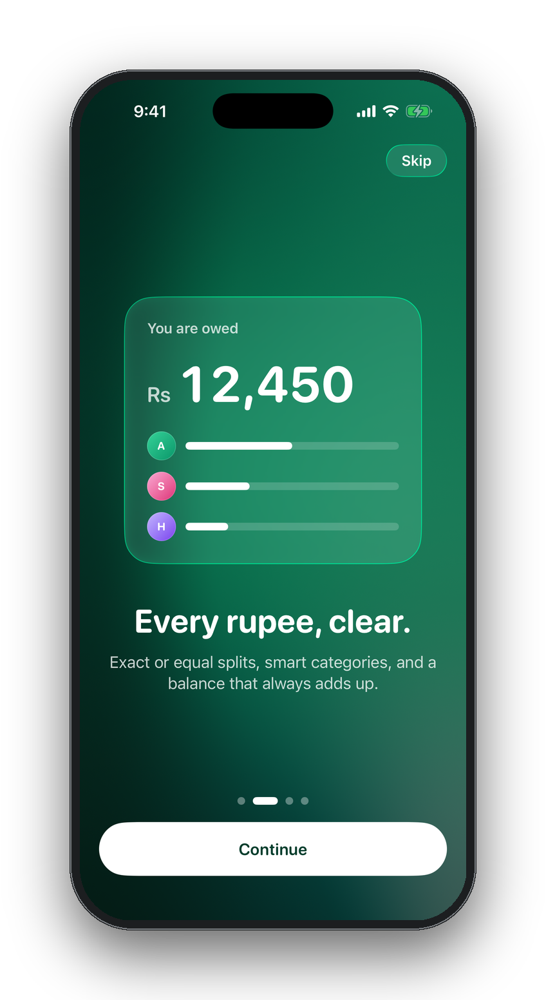<br><b>Every rupee, clear</b></td>
    <td align="center" width="25%">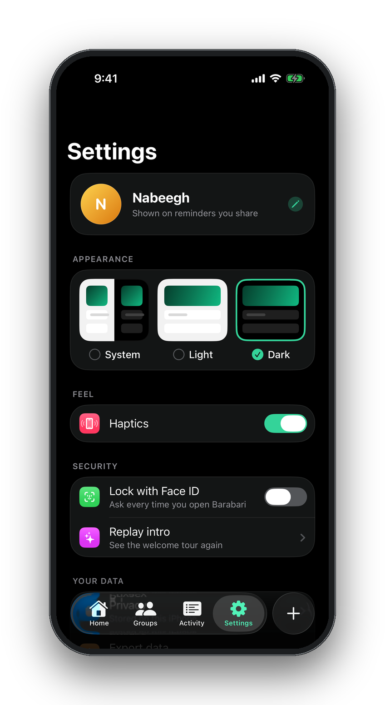<br><b>Face ID & appearance</b></td>
  </tr>
</table>

---

## Features

| | |
|---|---|
| 💸 **Expenses** | Equal or exact splits, paise-accurate rounding, any payer, any subset of people |
| 🏷️ **Smart categories** | 10 categories, auto-detected from titles like *biryani*, *Careem*, *K-Electric*, *Hunza hotel* |
| 👥 **People** | Add and rename group members; avatars with initials and colors |
| 🤝 **Settle up** | Record payments made with Raast, Easypaisa, JazzCash, a bank, cash or anything else; full or partial |
| 💬 **Reminders** | Share a balance card on WhatsApp, or anywhere else, in one tap |
| 📊 **Insights** | A “Where your money went” donut chart of your own share by category |
| 🔗 **Invites** | QR codes and `barabari://join` links |
| 📱 **Widget** | Net balance on your Home Screen and Lock Screen |
| 🔒 **Privacy** | Optional Face ID lock, hidden in the app switcher, data never leaves the phone |
| 📤 **Export** | Your whole ledger as JSON or CSV |
| ✨ **Feel** | Native Liquid Glass, spring animations, rolling numbers, haptics everywhere |

---

## Built with

- **SwiftUI** on **iOS 26**: the native Liquid Glass tab bar, `glassEffect`, zoom transitions, `MeshGradient`, SF Symbols animations
- **SwiftData** for the local ledger, with domain, data and feature layers kept separate so a sync backend can be added later
- **WidgetKit** for the Home Screen and Lock Screen balance widget
- **Swift Charts** for spending insights
- **LocalAuthentication** for the Face ID lock

Money is stored in paise (`Int64`), never as floating point, and splits are checked so they always add up to the exact total.

---

## Run it on your iPhone

1. Open `Barabari/Barabari.xcodeproj` in **Xcode 26** or later.
2. Pick the **Barabari** scheme and your iPhone.
3. Under *Signing & Capabilities*, choose your Apple Developer team (both the app and widget targets).
4. Press **Run** ▶︎.
5. The first time, trust the developer on your iPhone: **Settings → General → VPN & Device Management**.

### Tests

```sh
cd Barabari
xcodebuild test -scheme Barabari -destination 'platform=iOS Simulator,name=iPhone 17 Pro'
```

Unit tests cover the split math, the ledger, persistence, categories and keypad input. UI tests walk through adding expenses, settling up, invites and adding people.

---

## Roadmap

- [x] Local-first ledger with equal & exact splits
- [x] Liquid Glass redesign, onboarding, widget, Face ID
- [x] Real names, categories, WhatsApp reminders
- [ ] Cloud sync, so friends can join from their own phones
- [ ] Receipt scanning
- [ ] Recurring expenses (rent, bills)

---

<p align="center">
  Made with ☕ in Pakistan by <a href="https://github.com/M-Nabeegh">Nabeegh</a>
</p>
